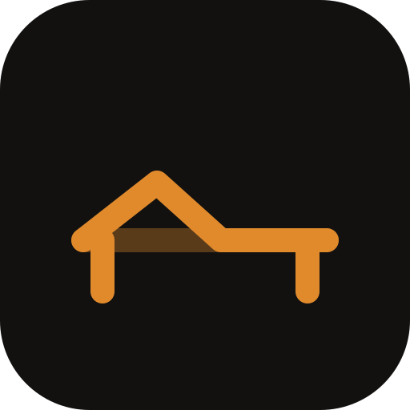

# Bed Remote for KSBT Beds

A simple Bluetooth remote app for Android that controls adjustable bed bases
with a **Keeson KSBT** controller, such as the **Member's Mark Premier**
adjustable base from Sam's Club.

No account, no sign-in, no ads and no internet access. Open it and it
reconnects to your bed by itself.

**Get it:** coming soon to Google Play.
**Website:** https://tntechdotdev.github.io/bed-remote/
**Privacy policy:** https://tntechdotdev.github.io/bed-remote/privacy.html
**Supported beds:** [SUPPORTED_BEDS.md](SUPPORTED_BEDS.md)

---

## Will it work with my bed?

It's **tested with controllers named `KSBT03C…`** (for example
`KSBT03C000012345`), the controller in the Member's Mark Premier base. Other
Keeson controllers whose name starts with **`KSBT`** may work but haven't been
tested yet. Controllers named `KSBT03CR…` use a different command format and
aren't supported.

To check:

1. Install the app and open **Settings** (the gear button).
2. Tap **Choose** next to *Bed*. The list only shows `KSBT…` controllers.
3. Pick yours.
   - `KSBT03C…` connects normally.
   - Another `KSBT` name connects with a note that it's untested. Use the free
     30 days to check every button and that the bed stops when you let go.
   - `KSBT03CR…` shows a message that it isn't supported.

If nothing shows up, make sure the bed is plugged in and no other app is
connected to it (see [Troubleshooting](#troubleshooting)). If it still doesn't
appear, your base probably uses a different controller and this app won't work
with it.

**See the full list: [Supported beds](SUPPORTED_BEDS.md)**, sorted into confirmed,
should work, might work, and not supported. The brand alone doesn't tell you:
the same brand has shipped with different controllers, so go by the Bluetooth
name.

## Getting started

1. Open the app. The first time, **Settings** opens by itself.
2. Allow **Nearby devices** when Android asks. That's the only permission it
   needs, and it never asks for your location on Android 12 or newer.
3. Under **Beds**, tap **Choose** and pick your `KSBT…` controller.
4. Close Settings. The status under the title turns to **● Connected**.

After that, the app reconnects whenever you open it.

## Using the remote

| Control | What it does |
|---|---|
| **Head / Tilt / Foot arrows** | **Press and hold** to move. Let go and the bed stops. |
| **Flat, Zero G, Anti-snore** | One tap moves the bed to that position. |
| **M1, M2, M3** | Go to a memory position saved with your bed's original remote. |
| **Massage − / +** | Change head or foot massage strength. **Timer** cycles the massage time. |

Tap the status line under the title (for example "● Connected") to open
Settings.

### Settings

- **Bluetooth:** turn the connection on or off. If you turn it off, the app
  stays off the next time you open it, which leaves the bed free for another
  phone or app.
- **Split bed:** for split kings (two mattresses with a controller for each side).
  Turn it on, add the second controller as **Bed B**, then use **A / Both / B**
  at the top of the main screen to choose which side the buttons control.
- **Vibrate on press:** a short buzz when you press a button.
- **Purchase:** see below.

### Free trial and unlock

Every feature is free to use. After 30 days, the app shows a short reminder
the first time you open it each day, offering a **one-time unlock**. Tap
**No thanks** and keep using it; nothing is ever locked. Unlocking stops the
reminder for good. There's no subscription, and the unlock applies to every
phone signed in to the same Google account (use **Restore purchase** in
Settings on a new phone).

## Troubleshooting

**The bed doesn't show up, or it says "Couldn't reach the bed".**
Your bed accepts **only one Bluetooth connection at a time**. If another app is
connected (for example the Member's Mark app on a phone or iPad), this app
can't connect. Close that app, or turn off its **Auto connect** setting. Some
apps quietly reconnect in the background. If in doubt, turn Bluetooth off on the
other device for a moment.

**It connected but the buttons are greyed out.**
They're greyed out until the status shows **● Connected**. On a split bed, the
selected side (A, Both or B) must be connected.

**It disconnects when I leave the app.**
That's on purpose. About 15 seconds after you switch away, the app lets go of
the bed so other devices can use it. It reconnects when you come back.

**A button does nothing on my bed.**
Not every base has every motor or feature. For example, some have no pillow
tilt or no massage.

## Safety

Before moving the bed, make sure nobody, especially children and pets, and
nothing is under, beside or between its moving parts. The bed only moves while
you hold an arrow and stops when you let go. Your bed's original remote keeps
working alongside the app.

## Privacy

The app collects no data and has no internet permission. It only uses Bluetooth
to talk to your bed. Its few settings, such as which bed you chose, stay on your
phone. The one-time unlock is handled by Google Play. Full details are in the
[privacy policy](https://tntechdotdev.github.io/bed-remote/privacy.html).

## Questions or problems

Use the developer contact on the app's Google Play page, or open an
[issue](https://github.com/tntechdotdev/bed-remote/issues) in this repository.

---

Bed Remote is an independent app. It is not made by, affiliated with or
endorsed by Keeson, Sam's Club or Member's Mark. Product names are used only to
describe compatibility.

The privacy policy here is a copy of the one built into the app; both are updated together.
